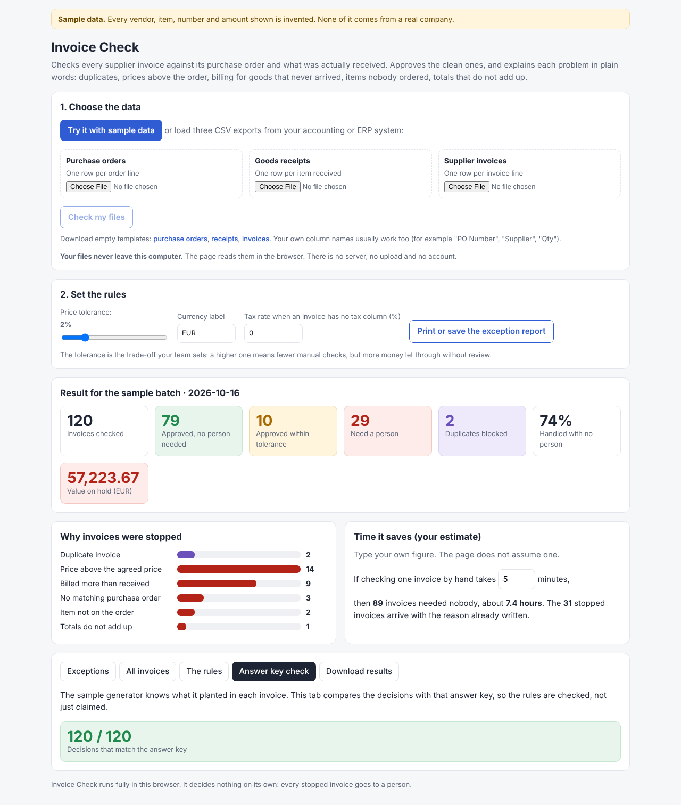

# Invoice Check



Invoice Check compares every supplier invoice with its purchase order and with what was actually received. It approves the clean invoices and explains each problem in plain words, with a suggested next step:

- the same invoice sent twice, even with the number written differently;
- a price above the agreed order price (you set the tolerance);
- billing for more than was received;
- items that were never ordered;
- totals that do not add up;
- invoices with no matching order, or more than one possible order.

It runs in a web browser. **Files never leave the computer**: there is no server, no upload and no account.

## How to run it

1. Keep the folder together (`index.html`, `engine.js`, `importer.js`).
2. Double-click `index.html`. It opens in any modern browser, with no internet connection needed.
3. Click **Try it with sample data** to see it on an invented batch, or load your three CSV files and click **Check my files**.
4. Set the price tolerance, the currency label and, if your invoice file has no tax column, the tax rate.
5. Use **Print or save the exception report** for a PDF, or **Download results** for spreadsheets.

## The three files

Export these from your accounting or ERP system as CSV. One row per line. Empty templates are in `templates/`, and a full invented example is in `sample/`.

| File | Required columns | Optional columns |
|---|---|---|
| Purchase orders | order number, vendor, order date, quantity, unit price, and an item code **or** description | description |
| Goods receipts | order number, quantity received | receipt number, receipt date, item code or description |
| Supplier invoices | invoice number, vendor, invoice date, quantity, unit price, total, and an item code **or** description | order number, subtotal, tax |

Your own column names usually work. For example "PO Number", "po_number" and "Purchase Order" are all read as the order number, and "Supplier" as the vendor. If a required column cannot be found, the page says which one and shows the columns it did find. It never guesses.

What the reader handles:

- comma, semicolon or tab separated files, with or without a byte-order mark;
- numbers such as `1,234.50`, `1.234,50`, `€ 12` and `(15.00)`;
- dates as `2026-01-31`, `31/01/2026`, `31.01.2026` or `01/31/2026` (day or month first is detected per file);
- invoice header values on every line, or only on the first line of each invoice;
- several deliveries against one order (quantities are added up);
- lines starting with `#` are ignored (used for notes such as "invented data").

Lines are matched by item code. When a file has no item code, the description is used instead, so descriptions must be written the same way in orders and invoices.

## Limits

- It reads CSV exports. It does not read PDF or emailed invoices. Turning PDFs into rows is a separate step.
- One invoice covering several orders, credit notes, and currency conversion are not handled yet. They show up as exceptions for a person.
- Two genuine invoices from the same vendor with the same total on the same order are flagged as a possible duplicate. A person confirms.
- It decides nothing on its own. It does not pay, change or send anything.

## Tests

```
node tests/test-import.js                              # importer and matching
NODE_PATH=$(npm root -g) node tests/browser-test.js    # page in a headless browser (needs Playwright)
```

Results (Node 22, Chromium via Playwright):

- 600 invented batches (200 seeds at 0%, 2% and 5% tolerance), 90,000 invoice decisions: identical whether the batch was matched directly or written to the three CSV files and read back.
- A messy file set (semicolons, byte-order mark, comma decimals, day-first dates, other column names, header values only on the first line, a missing order number, a re-sent invoice) gave the expected decisions.
- A file with missing columns is refused with a clear message.
- In the browser: the sample, the same data loaded as files, the detail view, the exceptions CSV, the broken-file message and the phone layout (no sideways scrolling at 390 px) all passed with no script errors.
- The matching rules come from the earlier demo, which agreed with its answer key on 210,000 decisions. That proves the rules do what they say on invented data. It does not predict accuracy on a real company's data: on real data, start by comparing its decisions with invoices a person has already approved or rejected.

## Files

| Path | What it is |
|---|---|
| `index.html` | The tool |
| `engine.js` | Matching rules and the invented sample generator |
| `importer.js` | Reads the three CSV files and reports problems in them |
| `templates/` | Empty CSV templates |
| `sample/` | Invented example files (seed 42, 120 invoices) |
| `tests/` | Automated checks |
| `screenshots/` | Pictures from the browser test |

## Why I built it

Checking invoices against orders and deliveries is one of the most common manual jobs in operations, and most of the money lost there is small, repeated mistakes nobody has time to catch. I built this to show how I approach that kind of work: clear rules a finance person can read, every decision explained, nothing changed without a person, and tests that prove the rules do what they say.

Everything here is built from scratch on invented data. It contains no code, data, rules, names or figures from any employer or client.

Built by [Mohammed Badawy](https://mohammedbadawy.com).
